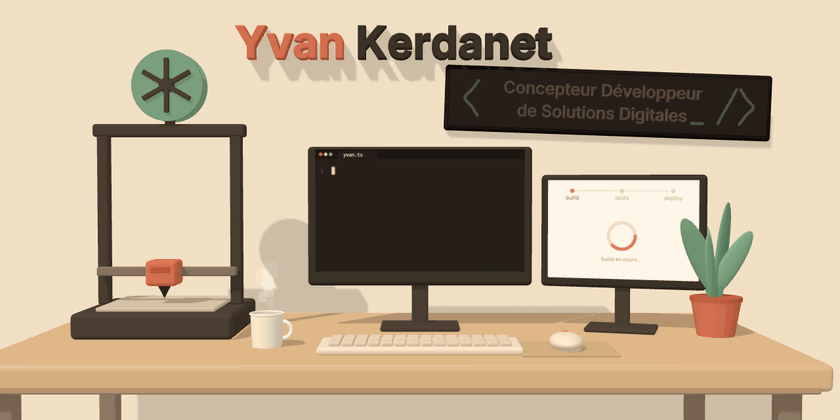

---

## 🚀 Disponible : CDD · CDI · Mission freelance

> Je cherche un poste de **développeur full-stack** en **CDD ou CDI**, ou une **mission en freelance**.
> Si vous avez un projet ou une équipe à renforcer, écrivez-moi, on en discute. 🤝

---

## 👨‍💻 À propos

- 🎓 Formé en *Développeur Concepteur de Solutions Digitales*, objectif Tech Lead
- 🛠️ J'aime concevoir un produit de bout en bout : UX, front, back, déploiement
- 🔁 Je mets de la CI/CD dès le début d'un projet (GitHub Actions, branches protégées, PR obligatoires)
- 🖨️ À côté : conception et impression 3D, automatisation de tout ce qui est répétitif
- 🦀 En ce moment : je découvre **Rust**
- 🔐 Prochaine étape : cybersécurité et IA

---

## 🧰 Stack

---

## 📌 Projets à la une

| Projet | Description | Stack |
|---|---|---|
| 🚇 [**UrbanFlow Mobility**](https://github.com/KerdanetYvan/urbanflow-mobility) | PWA de calcul d'itinéraire personnalisé pour une métropole, réalisée seul (projet de titre RNCP) : CI/CD, déploiement Docker sur VPS | Next.js · NestJS · PostgreSQL/PostGIS |
| 🌐 [**kerdanetyvan.dev**](https://kerdanetyvan.dev) | Mon portfolio et blog, avec un article sur la CI/CD et la protection de branches | Web |
| 📚 [**encyclope-dnd**](https://github.com/KerdanetYvan/encyclope-dnd) | Encyclopédie autour de D&D | TypeScript |

---

## 📊 Activité GitHub

---

📬 Recruteurs, RH, CTO, clients : **parlons CDD, CDI ou mission freelance** → [kerdanety@gmail.com](mailto:kerdanety@gmail.com)

